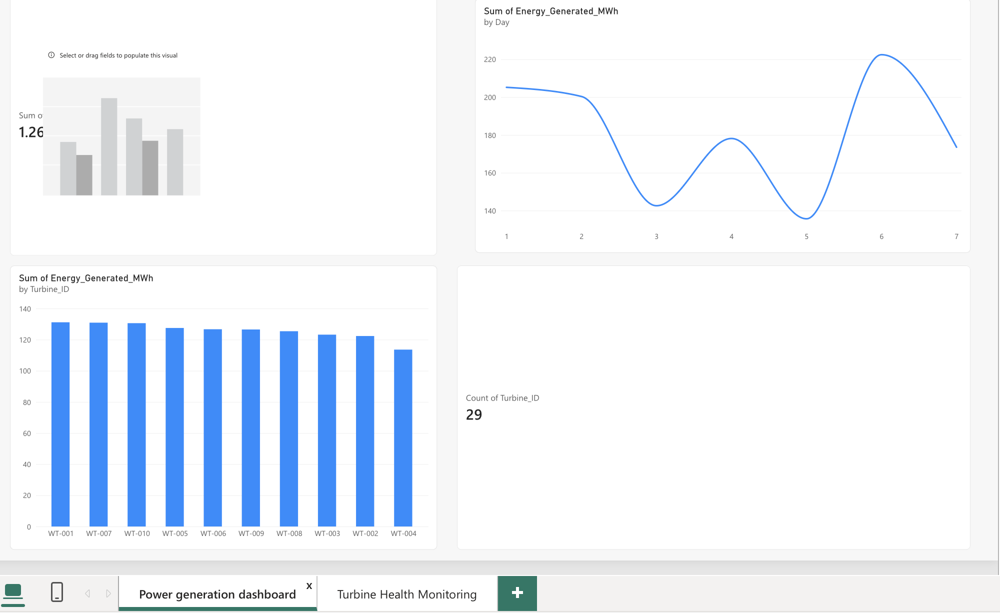
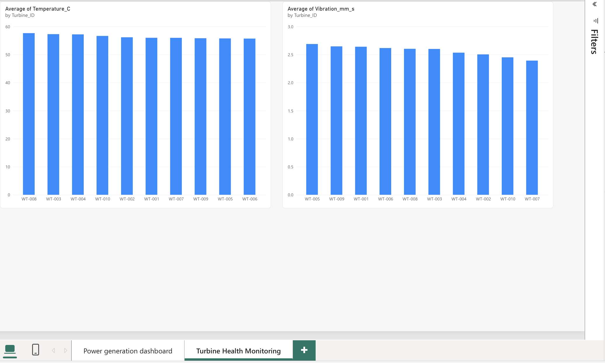

# Wind Farm Power Generation & Turbine Health Analytics

## Project Overview

A renewable energy analytics portfolio project using synthetic wind turbine sensor data and Microsoft Power BI.

The project analyses electricity generation, wind turbine performance, temperature, vibration and maintenance review indicators.

## Technologies Used

- Microsoft Power BI Service
- Power Query
- Power BI Semantic Model
- Microsoft Excel
- Data Visualisation and Analytics

## Implemented Architecture

Synthetic Wind Turbine Data (Excel)
→ Power Query Transformation
→ Power BI Semantic Model
→ Interactive Power BI Reports

## Dataset

- 10 wind turbines
- 7 days of hourly telemetry
- 1,680 synthetic sensor records
- Wind speed, power output, energy generation, temperature and vibration measurements

## Dashboard 1 — Power Generation Overview

- Total energy generated: approximately **1.26K MWh**
- Energy generation by turbine
- Daily energy generation trend
- **29 maintenance-review telemetry records**

## Dashboard 2 — Turbine Health Monitoring

- Average turbine temperature (°C)
- Average turbine vibration (mm/s)
- Comparison across 10 wind turbines

## Data Processing

- Imported an Excel dataset into Power BI Service.
- Converted Excel serial timestamps into Date/Time values using Power Query.
- Applied Sum aggregation for generated energy.
- Used Average aggregation for temperature and vibration.
- Filtered maintenance-review records using `Maintenance_Flag = REVIEW`.

## Future Enhancements

- Ingest telemetry into Azure Data Lake Storage Gen2.
- Add automated ingestion and transformations.
- Integrate Azure event-streaming services for near-real-time monitoring.

